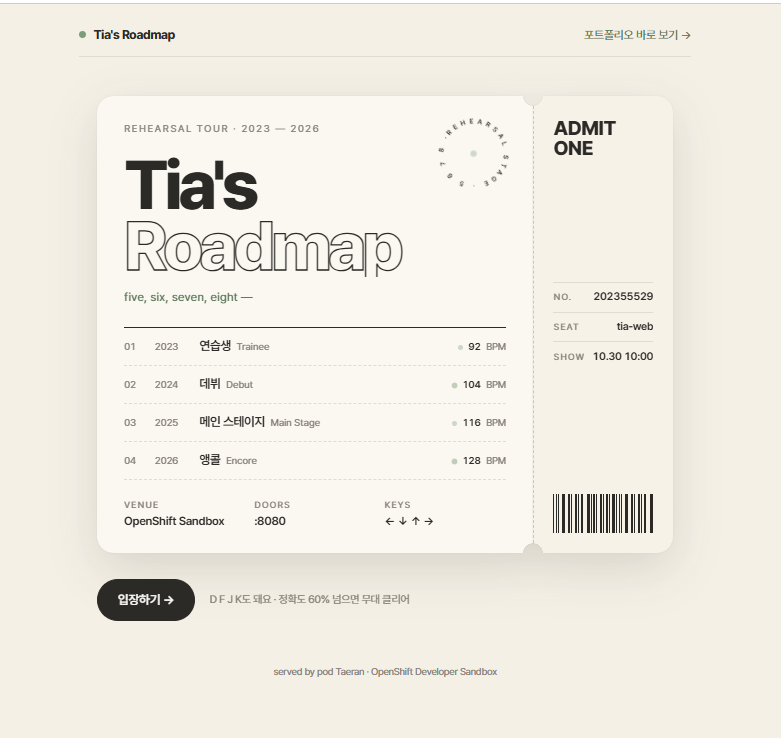
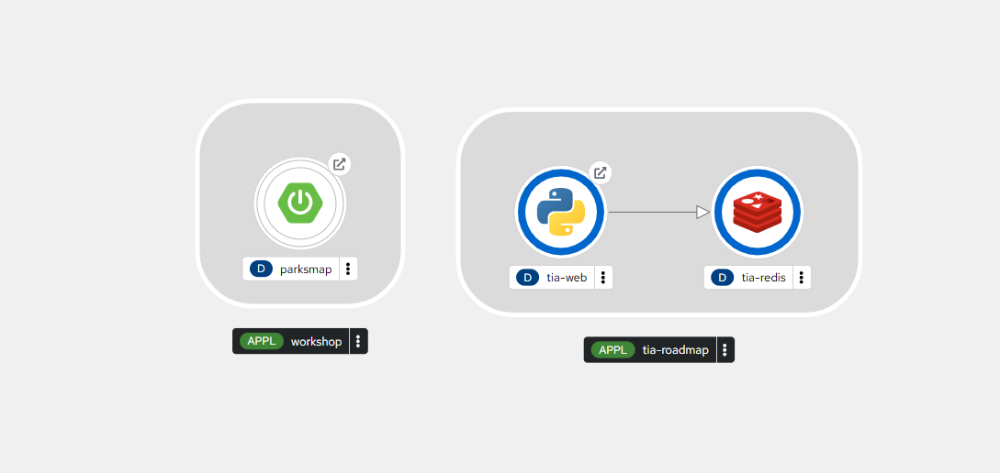
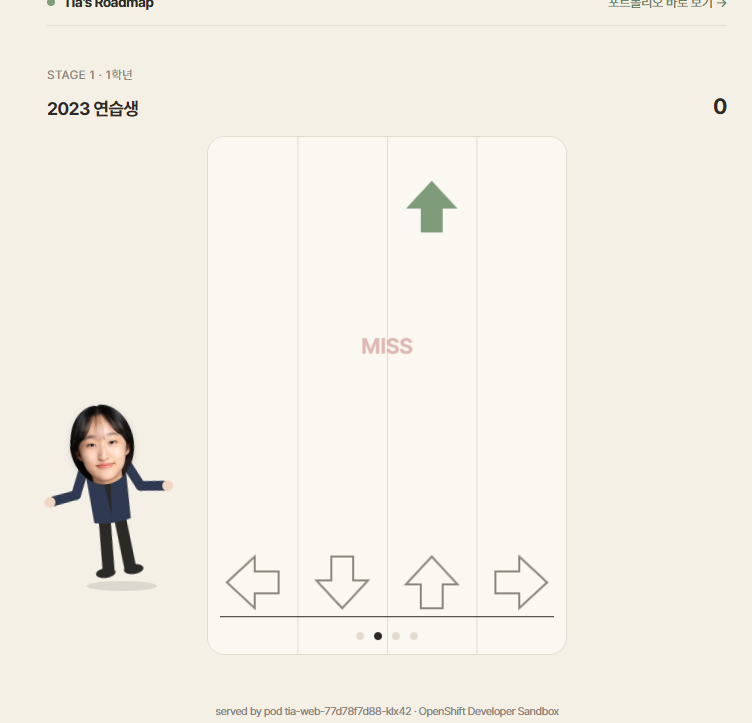
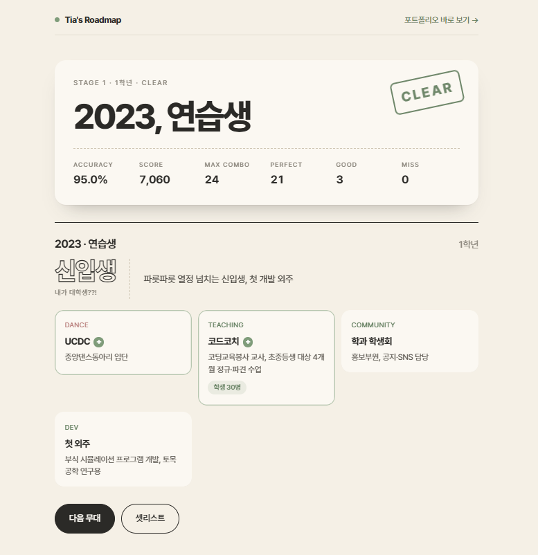
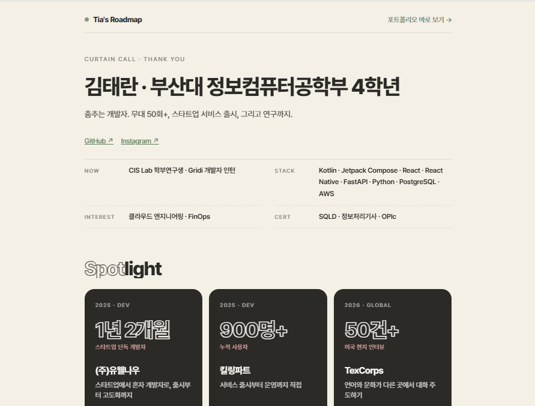

# Tia's Roadmap — 리허설 스테이지

> 지능형IoT플랫폼 8주차 과제 · 202355529 김태란
> **박자를 맞추면 그 해의 이야기가 열리는 리듬 게임형 포트폴리오** (Web + Redis 2-tier)

<!-- TODO: 배포 후 Route 주소로 접속한 메인 화면 캡처 -->


---

## 1. 컨테이너 소개

| 항목 | 내용 |
|---|---|
| 서비스 이름 | Tia's Roadmap — 리허설 스테이지 |
| 한 줄 설명 | 4레인 리듬 게임으로 학년별 무대를 클리어하면 그 해의 포트폴리오가 공개되고, 마지막 커튼콜 보드에 점수와 응원을 남길 수 있는 웹 서비스 |
| 구성 | Web(Python) + DB(Redis) 2-tier, 데이터는 PVC에 영구 저장 |

### 이 주제를 고른 이유

대학 1–2학년 동안 댄스동아리에서 공연 약 46건에 섰고, 3–4학년에는 개발과 연구로 무대를 옮겼습니다. "박자를 맞추는 사람"이라는 공통점을 컨셉으로 삼아, 제 4년을 **4개의 무대(Stage)** 로 나눴습니다. 학년이 올라갈수록 BPM과 노트 밀도가 올라가도록 설계해, 난이도 곡선 자체가 성장 서사가 되게 했습니다.

### 주요 기능

- **셋리스트**: 2023(1학년)~2026(4학년) 4개 무대. 이전 무대를 클리어해야 다음 무대가 열림
- **리듬 게임**: 방향키(← ↓ ↑ →) 또는 D F J K, 모바일은 하단 터치 패드. 정확도 60% 이상이면 클리어
- **챕터 공개**: 클리어한 무대의 연도·요약·활동 목록 표시
- **커튼콜 보드 (DB 연동)**: 전체 타임라인 + 리더보드(총점) + 응원 방명록
- **포트폴리오 바로 보기**: 게임을 하지 않아도 우측 상단 버튼으로 전체 내용 확인 가능
- 음원 파일 없이 Web Audio API로 메트로놈 비트를 생성 (저작권 문제 없음)

---

## 2. 아키텍처

```mermaid
flowchart LR
    U[사용자 브라우저] -->|HTTPS| R[Route<br/>tia-web<br/>edge TLS]
    R --> SW[Service<br/>tia-web :8080]
    SW --> PW[Pod: tia-web<br/>ubi9/python-311]
    PW -->|RESP :6379| SR[Service<br/>tia-redis]
    SR --> PR[Pod: tia-redis<br/>sclorg/redis-7-c9s]
    PR --- PVC[(PVC<br/>tia-redis-data 1Gi)]

    CM1[ConfigMap<br/>tia-web-app] -.server.py.-> PW
    CM2[ConfigMap<br/>tia-web-static] -.html/js/css.-> PW
    CM3[ConfigMap<br/>tia-portfolio] -.portfolio.json.-> PW
    SEC[Secret<br/>tia-redis-secret] -.REDIS_PASSWORD.-> PW
    SEC -.REDIS_PASSWORD.-> PR
```

**요청 흐름**: 사용자 → Route(HTTPS 종료) → Service `tia-web` → Web Pod → (API 요청 시) Service `tia-redis` → Redis Pod → PVC

Redis Service에는 Route를 만들지 않아 클러스터 외부에서 DB에 직접 접근할 수 없습니다.

### 사용한 Object

| 파일 | Object | 이름 | 역할 |
|---|---|---|---|
| `00-redis-secret.yaml` | Secret | tia-redis-secret | Redis 비밀번호. Web과 Redis 양쪽에 env로 주입 |
| `01-redis-pvc.yaml` | PersistentVolumeClaim | tia-redis-data | Redis AOF 파일 저장. Pod가 재생성돼도 데이터 유지 |
| `02-redis-deployment.yaml` | Deployment | tia-redis | DB tier. AOF 켜고 비밀번호 설정, tcpSocket Probe |
| `03-redis-service.yaml` | Service | tia-redis | 클러스터 내부 전용 접속 주소 |
| `04-web-configmap-app.yaml` | ConfigMap | tia-web-app | 웹 서버 코드(`server.py`) |
| `05-web-configmap-static.yaml` | ConfigMap | tia-web-static | 게임 화면(`index.html`, `game.js`, `style.css`) |
| `06-web-configmap-portfolio.yaml` | ConfigMap | tia-portfolio | 포트폴리오 데이터(`portfolio.json`) |
| `07-web-deployment.yaml` | Deployment | tia-web | App tier. ConfigMap 3개를 마운트해 실행, HTTP Probe |
| `08-web-service.yaml` | Service | tia-web | Web Pod 앞단 로드밸런싱 |
| `09-web-route.yaml` | Route | tia-web | 외부 HTTPS 주소, http→https 리다이렉트 |

### 설계 판단

- **ConfigMap을 3개로 분리한 이유**: 코드·화면·데이터는 바뀌는 주기가 다릅니다. 특히 포트폴리오 내용은 앞으로 계속 갱신할 예정이라, 코드를 건드리지 않고 `portfolio.json`만 바꿔 다시 적용할 수 있게 했습니다.
- **Probe를 두 종류로 나눈 이유**: Liveness는 `/healthz`(프로세스 생존)만, Readiness는 `/readyz`(Redis 연결까지)로 분리했습니다. Redis가 늦게 뜨거나 재시작될 때 Web까지 재시작되는 연쇄 장애를 막고, 트래픽만 잠시 차단되도록 했습니다.
- **Redis Deployment를 `Recreate` 전략으로 둔 이유**: PVC가 ReadWriteOnce라 롤링 업데이트 중 새 Pod와 기존 Pod가 같은 볼륨을 동시에 붙잡으면 새 Pod가 뜨지 못할 수 있습니다.
- **Redis 클라이언트를 직접 구현한 이유**: `pip install redis`를 컨테이너 시작 시점에 하면 네트워크 상황에 따라 채점 환경에서 실패할 수 있습니다. RESP 프로토콜은 단순해서 표준 라이브러리 `socket`만으로 필요한 명령(AUTH, PING, ZADD, ZREVRANGE, LPUSH 등)을 구현했습니다.
- **보안**: 비루트 실행, 권한 상승 금지, capabilities 전부 제거, 입력 길이 제한과 HTML 이스케이프(XSS 방지).

---

## 3. 사용 이미지

| Tier | 이미지 | 포트 | 선택 이유 |
|---|---|---|---|
| Web | `registry.access.redhat.com/ubi9/python-311:latest` | 8080 | Red Hat UBI 이미지로 OpenShift의 임의 UID 비루트 실행을 지원. Python 표준 라이브러리만으로 서버를 구현해 추가 패키지가 필요 없음 |
| DB | `quay.io/sclorg/redis-7-c9s:latest` | 6379 | Red Hat 이미지와 같은 sclorg 소스로 빌드된 CentOS Stream 9 기반 공개 이미지. 비루트(임의 UID) 실행 지원, 인증 없이 pull 가능, Docker Hub 다운로드 제한 회피 |

두 이미지 모두 직접 빌드하지 않고 공개 이미지를 그대로 사용했습니다. 실행 명령은 Deployment의 `command`로 지정했습니다.

---

## 4. 배포 방법

```bash
# 학번 폴더에서
oc apply -f k8s/

# 상태 확인 (Pod 2개가 Running, READY 1/1이 될 때까지)
oc get pods -w

# 접속 주소 확인
oc get route tia-web -o jsonpath='https://{.spec.host}{"\n"}'
```

### 배포 후 확인 방법

| 경로 | 예상 응답 |
|---|---|
| `https://<route>/` | 인트로 화면 "네 번의 무대, 네 번의 학년." |
| `https://<route>/readyz` | `{"status": "ready", "redis": "ok"}` |
| `https://<route>/api/portfolio` | 포트폴리오 JSON |
| `https://<route>/api/scores` | `{"scores": [...]}` (처음엔 빈 배열) |

빠르게 확인하려면 우측 상단 **포트폴리오 바로 보기 →** 를 누르면 커튼콜 보드로 바로 이동합니다.

### 포트폴리오 내용 수정 시

```bash
# src/portfolio.json 수정 후
python scripts/gen_configmaps.py   # k8s/ ConfigMap 재생성
oc apply -f k8s/
oc rollout restart deployment/tia-web
```

`src/`는 ConfigMap의 원본 소스이고, 채점 대상은 `k8s/` 폴더뿐입니다.

---

## 5. 배포 결과

<!-- TODO: 아래 캡처를 images/ 에 저장 -->

### oc get all

```text
(oc get all 출력 붙여넣기)
```

### Topology



### 브라우저 접속 화면

| 게임 플레이 | 무대 클리어 | 커튼콜 보드 |
|---|---|---|
|  |  |  |

### 재현성 검증

```bash
oc delete -f k8s/
oc apply -f k8s/
```

삭제 후 `k8s/` 폴더만으로 재배포해 정상 동작을 확인했습니다.

### 데이터 유지 검증 (PVC)

```bash
# 리더보드에 기록을 남긴 뒤 Redis Pod 삭제
oc delete pod -l app.kubernetes.io/name=tia-redis
# 새 Pod가 Running 된 후 기록이 그대로 남아 있는지 확인
curl -s https://<route>/api/scores
```

<!-- TODO: 삭제 전/후 결과 캡처 또는 출력 붙여넣기 -->

---

## 6. 어려웠던 점

### 배포 중 겪은 오류

**1. Redis Pod `ImagePullBackOff`**

- **증상**: `oc apply -f k8s/` 후 `tia-redis` Pod가 `ImagePullBackOff`, `tia-web`은 Redis에 연결하지 못해 Readiness 실패(0/1)
- **원인**: `oc describe pod`의 이벤트에 `This repo requires terms acceptance and is only available on registry.redhat.io`가 표시됐습니다. `rhel9/redis-7`은 `registry.access.redhat.com`(인증 불필요)이 아니라 로그인이 필요한 `registry.redhat.io`에서만 받을 수 있는 이미지였습니다. 반면 Web의 `ubi9/python-311`은 UBI라서 인증 없이 받을 수 있었습니다.
- **해결**: 같은 [sclorg/redis-container](https://github.com/sclorg/redis-container) 소스로 빌드된 공개 이미지 `quay.io/sclorg/redis-7-c9s`로 교체했습니다. 실행 사용자(1001)와 데이터 경로(`/var/lib/redis/data`)가 같아서 이미지 외 설정은 바꾸지 않았습니다. 채점 환경에서도 pull 시크릿 없이 배포되도록, 교체 전에 `oc image info`로 인증 없이 매니페스트를 조회할 수 있는지 확인했습니다.

### 설계 단계에서 고민한 점

- **pip 없이 Redis에 붙기**: 처음에는 컨테이너 시작 시 `pip install redis`를 고려했지만, 채점 환경에서 외부 네트워크 상태에 의존하게 되는 문제가 있었습니다. RESP 프로토콜을 직접 구현해 의존성을 없앴습니다.
- **Redis 기동 순서**: Web Pod가 Redis보다 먼저 뜨면 첫 요청이 실패합니다. 요청마다 짧게 재연결하는 구조와 Readiness Probe(`/readyz`)를 조합해, Redis가 준비되기 전에는 트래픽을 받지 않도록 했습니다.

---

## 7. AI·참고자료 활용 내역

| 도구 | 용도 |
|---|---|
| Claude (claude.ai) | 컨셉 아이디어 정리, Kubernetes YAML·Python 서버·게임 코드 초안 작성, README 구조 정리 |
| 직접 수행 | Developer Sandbox 배포, 동작 확인, 재현성 검증, 캡처, 포트폴리오 내용 작성·검토 |

AI가 작성한 YAML은 본인 Sandbox에 직접 배포해 동작을 확인한 뒤 제출했습니다.

**참고 문서**

- [quay.io/sclorg/redis-7-c9s](https://quay.io/repository/sclorg/redis-7-c9s)
- [sclorg/redis-container (Redis 이미지 환경변수·데이터 경로)](https://github.com/sclorg/redis-container)
- [Redis Serialization Protocol (RESP)](https://redis.io/docs/latest/develop/reference/protocol-spec/)
- [Kubernetes — Configure Liveness, Readiness Probes](https://kubernetes.io/docs/tasks/configure-pod-container/configure-liveness-readiness-startup-probes/)
- [OpenShift — Route configuration](https://docs.redhat.com/en/documentation/openshift_container_platform/latest/html/networking/configuring-routes)
